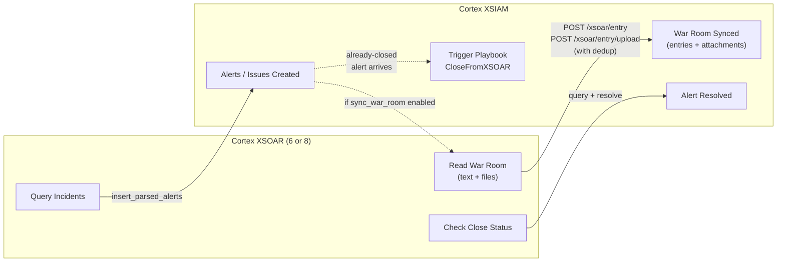

# Xporter

Content pack for exporting Cortex XSOAR 6 or XSOAR 8 incidents into Cortex XSIAM as parsed alerts, with War Room sync (text + file attachments), incomplete sync logging, and bidirectional close status propagation.

## How It Works



### Flow 1: Incident Push + War Room Sync

1. Integration queries the local XSOAR API for incidents matching a configurable filter
2. Maps each incident to the XSIAM parsed alert schema with full context (ID, name, status, severity, owner, close reason, custom fields, labels)
3. Posts alerts to XSIAM via the Insert Parsed Alerts API
4. If **Sync War Room entries on push** is enabled:
   - Reads War Room entries from each incident
   - Text entries (type 1) pushed via `POST /xsoar/entry` with metadata header
   - File attachments (type 3) downloaded from XSOAR and uploaded via `POST /xsoar/entry/upload/{investigation_id}`
   - Deduplication via `[XSOAR War Room]` markers in entry content and file comments
   - Incidents with incomplete syncs (alert not found, read failures, entry errors) are logged and surfaced in command output

War Room entries land before close sync can shut the issue.

### Flow 2: Close Sync (Polling)

Runs from XSOAR via `sync-close-status`. Queries XSIAM for open XSOAR-sourced alerts, checks if the source XSOAR incident has been closed, and resolves the alert with the mapped close reason. Catches incidents closed after they were already pushed.

### Flow 3: Close Sync (Real-time)

Runs entirely on XSIAM. When an already-closed incident arrives as a new alert, the **Close XSIAM Case From XSOAR** trigger playbook fires. The `CloseFromXSOAR` script parses the alert description and auto-closes the XSIAM case.

## Commands

| Command | Description |
|---|---|
| `!xsoar-exporter-push-incidents` | Bulk push incidents matching a query |
| `!xsoar-exporter-push-incident` | Push a single incident by ID |
| `!xsoar-exporter-sync-new-incidents` | Find and push only new incidents not yet synced |
| `!xsoar-exporter-reset-sync` | Reset sync state so next sync sends all incidents |
| `!xsoar-exporter-sync-close-status` | Resolve XSIAM alerts whose XSOAR incidents are closed |
| `!xsoar-exporter-sync-war-room` | Sync War Room entries for a specific incident (standalone) |

## Configuration

| Parameter | Description |
|---|---|
| Cortex XSOAR Server URL | XSOAR 6: `https://{ip}`. XSOAR 8: `https://api-{tenant}.xdr.us.paloaltonetworks.com` |
| Cortex XSOAR API Key | API key for XSOAR authentication |
| Cortex XSOAR API Key ID | XSOAR 8 only. Leave blank for XSOAR 6 |
| Cortex XSIAM API URL | `https://api-{tenant}.xdr.us.paloaltonetworks.com` |
| Cortex XSIAM API Key | API key for XSIAM authentication |
| Cortex XSIAM API Key ID | Key ID associated with the XSIAM API key |
| Incident query filter | Optional XSOAR query to filter incidents (e.g., `type:Phishing`) |
| Maximum incidents per push | Batch size limit (default: 100) |
| Elevate Low severity to Medium | Map Low to Medium so alerts create cases and trigger playbooks |
| Timestamp offset (minutes) | Shift old XSOAR timestamps forward so XSIAM doesn't drop them |
| Sync War Room entries on push | Automatically sync War Room entries (text + file attachments) when pushing incidents |

## Setup

### 1. Install and Configure

Upload the pack to your Cortex XSOAR instance. Create an integration instance with your XSOAR and XSIAM credentials. Hit **Test** to verify connectivity.

### 2. Initial Bulk Export

```
!xsoar-exporter-sync-new-incidents max_incidents="100"
```

Each run picks up where the last one left off. Run repeatedly until all incidents are synced. To start over: `!xsoar-exporter-reset-sync`.

### 3. Ongoing Sync

Create a scheduled job in XSOAR that runs `!xsoar-exporter-sync-new-incidents` on an interval (e.g., every 15 minutes). Only new incidents are sent each run.

### 4. Close Status Sync

Run `!xsoar-exporter-sync-close-status` on a schedule to resolve XSIAM alerts whose source XSOAR incidents have closed.

For real-time close sync, configure the **Close XSIAM Case From XSOAR** playbook as a trigger playbook in XSIAM (Settings > Automation & Feed > Trigger Playbooks).

### 5. War Room Sync

Enable **Sync War Room entries on push** in the integration configuration to automatically sync War Room entries during incident push. Text entries and file attachments are synced with deduplication so re-pushes do not create duplicates.

To sync War Room entries for a specific incident on demand:

```
!xsoar-exporter-sync-war-room incident_id="12345"
```

Incomplete syncs (e.g., XSIAM alert not yet ingested, entry push failures) are logged in the integration logs and reported in the command output with per-incident status.

## Severity Mapping

| XSOAR Severity | XSIAM Severity | XSIAM Entity |
|---|---|---|
| Low (1) | Low | Issue |
| Medium (2) | Medium | Case |
| High (3) | High | Case |
| Critical (4) | Critical | Case |

With **Elevate Low severity to Medium** enabled, Low severity incidents become Medium and create cases instead of issues.

## Pack Structure

```
Packs/XSOARIncidentExporter/
├── pack_metadata.json
├── Integrations/
│   └── XSOARIncidentExporter/
│       ├── XSOARIncidentExporter.py
│       ├── XSOARIncidentExporter.yml
│       ├── XSOARIncidentExporter_test.py
│       └── command_examples.txt
├── Scripts/
│   └── CloseFromXSOAR/
│       ├── CloseFromXSOAR.py
│       └── CloseFromXSOAR.yml
└── Playbooks/
    └── Close_XSIAM_Case_From_XSOAR.yml
```

## License

MIT
